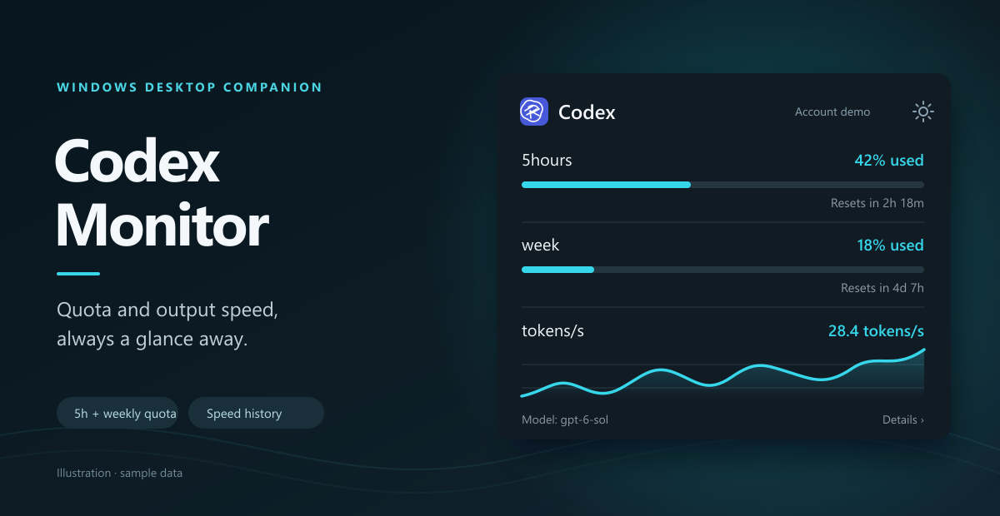

# Codex Monitor

[English](README.md) · [简体中文](README.zh-CN.md)

Windows Codex 用量浮窗。不需要查看时，它会留在系统托盘。



## 主要功能

- **配额：**查看 5 小时与每周用量、进度条和重置时间。
- **输出速度：**根据本机 Codex 会话估算 tokens/s，并显示最近 5 分钟的平滑曲线；详情页可切换 15 分钟、1 小时、24 小时、3 天和 7 天。
- **适应桌面：**拖动窗口、从边缘缩放，按需开启始终置顶；单击托盘图标显示浮窗或将其带到前台，通过托盘菜单隐藏浮窗。

## 本机运行

需要 Windows、.NET 9、Windows App SDK 运行时，以及已登录的 Codex CLI 或 Codex 桌面版。可在 Visual Studio 中打开 `CodexMonitor.sln` 并运行 `CodexMonitor.App`，也可执行：

```powershell
dotnet run --project .\src\CodexMonitor.App\CodexMonitor.App.csproj
```

若 `codex.exe` 不在 `PATH` 中，可将 `CODEX_MONITOR_CODEX_PATH` 设置为其完整路径。

## 数据与隐私

配额来自本机 Codex app-server。速度依据 `~/.codex/sessions` 中的输出 token 增量**估算**，不是服务端逐 token 的实时数据。显示历史和设置保存在 `%LOCALAPPDATA%\CodexMonitor`；应用不会把提示词或登录令牌写入缓存，完全的本地运行，无任何网络服务。
